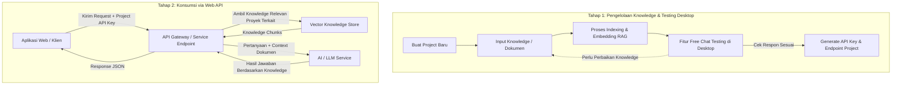

# Multiple RAG Project

Sistem manajemen Knowledge Base AI modular berbasis Retrieval-Augmented Generation (RAG) yang memungkinkan pembuatan, pengelolaan, dan isolasi knowledge secara spesifik per project. Setiap project menghasilkan API mandiri yang dapat langsung dikonsumsi oleh aplikasi web atau pihak ketiga.

---

## 📌 Pengertian & Konsep Dasar

Aplikasi ini dirancang sebagai platform untuk melatih pemahaman AI terhadap knowledge spesifik per project tanpa harus melatih ulang bobot model AI (*no weight retraining*). Melalui pendekatan **RAG (Retrieval-Augmented Generation)**, AI dapat memahami dokumen, SOP, aturan bisnis, dan data internal secara akurat, terisolasi, serta bebas dari pencampuran konteks antar project.

### Karakteristik Utama:
- **Project-Level Knowledge Isolation**: Knowledge milik Project A tidak akan pernah bercampur atau diakses oleh Project B.
- **Dedicated Project API**: Setiap project yang dibuat memiliki akses API sendiri (berbasis autentikasi API Key / Dynamic Route) untuk dikonsumsi langsung oleh aplikasi web atau integrasi eksternal.
- **Interactive Free Chat Testing**: Tersedia fitur chat interaktif langsung di desktop app untuk menguji keakuratan respon AI terhadap knowledge project sebelum digunakan di web/production.
- **Accurate & Up-to-Date**: Memanfaatkan retrieval dokumen yang relevan untuk meminimalkan halusinasi AI serta mempermudah pembaruan data kapan saja.

---

## 🔄 Workflow Sistem

Alur kerja aplikasi terbagi menjadi dua tahap utama: **Tahap Pengelolaan Knowledge & Testing (Trainer/Admin Desktop)** dan **Tahap Konsumsi (Web API)**.



### Penjelasan Alur:

1. **Pembuatan Project & Input Knowledge**:
   - Pengguna membuat entitas project baru (misal: *SOP Perusahaan*, *Customer Support Produk X*).
   - Pengguna memasukkan dokumen knowledge yang relevan khusus untuk project tersebut.

2. **Indexing & Ekstraksi RAG**:
   - Sistem memecah knowledge menjadi potongan-potongan konteks (*chunks*) dan memprosesnya ke dalam representasi vektor numerik (*embeddings*).
   - Seluruh data knowledge ditandai secara ketat dengan identitas project terkait.

3. **Free Chat Testing di Desktop**:
   - Desktop app menyediakan antarmuka **Free Chat** untuk menguji pemahaman AI terhadap knowledge project secara langsung.
   - Memastikan AI menjawab sesuai konteks dokumen sebelum API project di-publish atau dikonsumsi oleh aplikasi web.

4. **Penerbitan Dedicated API**:
   - Setelah hasil testing valid, sistem menerbitkan konfigurasi dan API Key unik untuk project tersebut sehingga siap diakses.

5. **Konsumsi oleh Aplikasi Web**:
   - Aplikasi web memanggil endpoint API dengan menyertakan kredensial/API Key project.
   - Sistem secara otomatis mencari knowledge yang relevan khusus dari project tersebut dan meneruskannya ke AI untuk menghasilkan jawaban yang presisi.

---

## 💻 Fitur Aplikasi Desktop

- **Manajemen Multi-Project**: Buat dan isolasi berbagai project AI dalam satu aplikasi desktop.
- **Knowledge Ingestion**: Import dokumen dan bahan bacaan untuk diolah menjadi basis pengetahuan RAG.
- **Free Chat (Testing Playground)**: Ruang percakapan interaktif untuk memvalidasi apakah AI sudah merespons dengan benar sesuai dokumen project yang dilatih.
- **API Key & Project Config**: Manajemen kredensial akses untuk integrasi API ke web eksternal.

---

## 🚀 Panduan Instalasi & Menjalankan Desktop App

### Prasyarat Sistem
- **Java Development Kit (JDK)**: Versi 21 atau lebih baru (direkomendasikan JDK 21 / JDK 25).
- **Koneksi Internet**: Untuk unduhan dependensi Maven pada saat pertama kali build.

### Langkah Instalasi

1. **Clone Repository**:
   ```bash
   git clone https://github.com/RP-Guruh/multiple-rag-project.git
   cd multiple-rag-project
   ```

2. **Beri Hak Eksekusi Maven Wrapper (Linux/macOS)**:
   ```bash
   chmod +x mvnw
   ```

3. **Jalankan Aplikasi Desktop**:
   * **Linux / macOS**:
     ```bash
     ./mvnw spring-boot:run
     ```
   * **Windows (Command Prompt / PowerShell)**:
     ```cmd
     mvnw.cmd spring-boot:run
     ```

Setelah proses build selesai, jendela aplikasi desktop JavaFX modern akan otomatis terbuka di layar Anda.

### Build Executable JAR (Opsional)
Untuk mengompilasi aplikasi menjadi file executable JAR:
```bash
./mvnw clean package -DskipTests
```
File JAR hasil build akan tersedia di folder `target/` dan dapat dijalankan dengan:
```bash
java -jar target/*.jar
```
