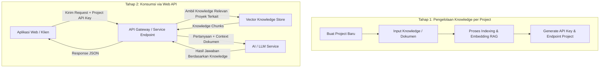

# Multiple RAG Project

Sistem manajemen Knowledge Base AI modular berbasis Retrieval-Augmented Generation (RAG) yang memungkinkan pembuatan, pengelolaan, dan isolasi knowledge secara spesifik per project. Setiap project menghasilkan API mandiri yang dapat langsung dikonsumsi oleh aplikasi web atau pihak ketiga.

---

## 📌 Pengertian & Konsep Dasar

Aplikasi ini dirancang sebagai platform untuk melatih pemahaman AI terhadap knowledge spesifik per project tanpa harus melatih ulang bobot model AI (*no weight retraining*). Melalui pendekatan **RAG (Retrieval-Augmented Generation)**, AI dapat memahami dokumen, SOP, aturan bisnis, dan data internal secara akurat, terisolasi, serta bebas dari pencampuran konteks antar project.

### Karakteristik Utama:
- **Project-Level Knowledge Isolation**: Knowledge milik Project A tidak akan pernah bercampur atau diakses oleh Project B.
- **Dedicated Project API**: Setiap project yang dibuat memiliki akses API sendiri (berbasis autentikasi API Key / Dynamic Route) untuk dikonsumsi langsung oleh aplikasi web atau integrasi eksternal.
- **Accurate & Up-to-Date**: Memanfaatkan retrieval dokumen yang relevan untuk meminimalkan halusinasi AI serta mempermudah pembaruan data kapan saja.

---

## 🔄 Workflow Sistem

Alur kerja aplikasi terbagi menjadi dua tahap utama: **Tahap Pengelolaan Knowledge (Trainer/Admin)** dan **Tahap Konsumsi (Web API)**.

### Penjelasan Alur:

1. **Pembuatan Project & Input Knowledge**:
   - Pengguna membuat entitas project baru (misal: *SOP Perusahaan*, *Customer Support Produk X*).
   - Pengguna memasukkan dokumen knowledge yang relevan khusus untuk project tersebut.

2. **Indexing & Ekstraksi RAG**:
   - Sistem memecah knowledge menjadi potongan-potongan konteks (*chunks*) dan memprosesnya ke dalam representasi vektor numerik (*embeddings*).
   - Seluruh data knowledge ditandai secara ketat dengan identitas project terkait.

3. **Penerbitan Dedicated API**:
   - Sistem menerbitkan konfigurasi dan API Key unik untuk project tersebut sehingga siap diakses.

4. **Konsumsi oleh Aplikasi Web**:
   - Aplikasi web memanggil endpoint API dengan menyertakan kredensial/API Key project.
   - Sistem secara otomatis mencari knowledge yang relevan khusus dari project tersebut dan meneruskannya ke AI untuk menghasilkan jawaban yang presisi.
