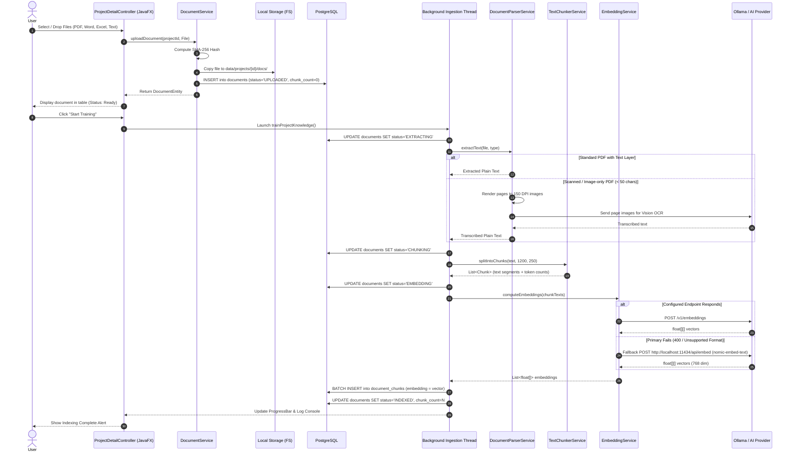
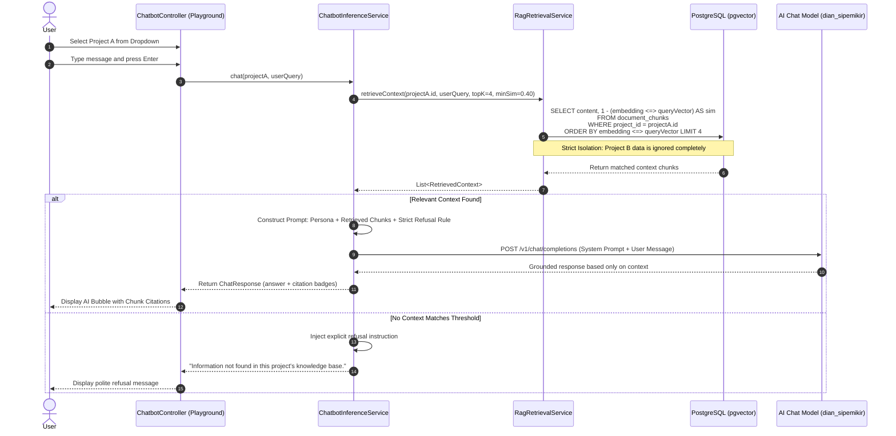

# RAG Studio — Multi-Project AI Platform

A local, project-isolated Retrieval-Augmented Generation (RAG) studio and inference engine built on **Java 21/25**, **Spring Boot 4**, **JavaFX 23**, and **PostgreSQL (`pgvector`)**.

RAG Studio provides a native desktop interface for document ingestion, multimodal vision OCR fallback, coordinate-sorted text extraction, text chunking, vector embedding, and real-time chat evaluation with strict knowledge boundaries per project.

---

## Architecture & Technology Stack

```
+---------------------------------------------------------------------------------+
|                                 USER INTERFACE                                  |
|         JavaFX 23 Desktop UI | AtlantaFX Themes | Ikonli Material Icons         |
|  [ Dashboard ]     [ Project Detail & Upload ]     [ Chatbot Playground ]       |
+---------------------------------------+-----------------------------------------+
                                        | Event / Controller Invocation
                                        v
+---------------------------------------------------------------------------------+
|                               APPLICATION CORE                                  |
|                 Spring Boot 4 Application Context & Dependency Injection        |
|                                                                                 |
|  +--------------------+  +----------------------+  +-------------------------+  |
|  |   DocumentService  |  | TextChunkerService   |  | ChatbotInferenceService |  |
|  +--------------------+  +----------------------+  +-------------------------+  |
|  +--------------------+  +----------------------+  +-------------------------+  |
|  | DocumentParserSvc  |  | EmbeddingService     |  | RagRetrievalService     |  |
|  | (PDFBox + Vision)  |  | (Ollama + OpenAI)    |  | (pgvector HNSW Cosine)  |  |
|  +--------------------+  +----------------------+  +-------------------------+  |
+------------------------+------------------------------------+-------------------+
                         |                                    |
                         v                                    v
+-----------------------------------+        +------------------------------------+
|       LOCAL APP STORAGE           |        |      POSTGRESQL + PGVECTOR         |
|  SQLite (Local app config)        |        |  Dynamic Hikari Connection Pool    |
|  Disk (data/projects/{id}/docs/)  |        |  projects, documents,              |
|                                   |        |  document_chunks (embedding vector)|
+-----------------------------------+        +------------------------------------+
```

### Component Breakdown

| Layer | Component | Implementation |
|---|---|---|
| **Runtime & Core** | Java 21/25, Spring Boot 4.1.2 | Dependency injection, application lifecycle bridge, embedded web container. |
| **Desktop UI** | JavaFX 23, AtlantaFX 2.0, Ikonli 12.4 | Modern desktop interface, custom AI vector branding, reactive event bus. |
| **Document Extraction** | Apache PDFBox 3.0.3, Apache POI 5.3.0 | PDF text stripping, Word docx paragraph parser, Excel tabular sheet extractor. |
| **Multimodal Vision OCR** | Ollama (`llava`) / OpenAI Vision | Renders scanned PDF pages to 150 DPI JPEG and transcribes text verbatim via Vision LLM. |
| **Chunking Engine** | Custom Recursive Chunker | Split threshold 1200 characters with 250 overlap, splitting on natural breaks (`\n\n`, `. `, `? `, `! `, `\n`). |
| **Embedding Client** | Java HTTP Client (HTTP/2) | Primary OpenAI-compatible endpoint with automatic fallback to local Ollama (`nomic-embed-text`, 768 dim). |
| **Vector Database** | PostgreSQL + `pgvector` | HNSW cosine similarity index (`vector_cosine_ops`), managed dynamically via Flyway migrations. |
| **Retrieval Engine** | Hybrid Vector + Keyword Search | Cosine similarity combined with exact substantive keyword matching (`ILIKE`) to guarantee high-precision menu/pricing retrieval. |
| **Rich Chat Formatter** | JavaFX TextFlow Markdown Engine | Native bolding and styling without exposing raw markdown asterisks (`**`). |
| **Metadata Storage** | SQLite (`data/app.db`) | Stores application configuration, encrypted API tokens, and database credentials locally. |

---

## RAG Workflow & Sequence Diagrams

### 1. Document Upload & Ingestion Pipeline



---

### 2. Isolated Chat Inference & Context Retrieval



---

## Database Schemas

### PostgreSQL (Knowledge & Vectors)

```sql
-- Projects Table
CREATE TABLE projects (
    id            BIGINT GENERATED BY DEFAULT AS IDENTITY PRIMARY KEY,
    name          VARCHAR(255) NOT NULL,
    description   TEXT,
    system_prompt TEXT,
    created_at    TIMESTAMPTZ NOT NULL DEFAULT now(),
    updated_at    TIMESTAMPTZ NOT NULL DEFAULT now()
);

-- Documents Metadata Table
CREATE TABLE documents (
    id            BIGINT GENERATED BY DEFAULT AS IDENTITY PRIMARY KEY,
    project_id    BIGINT NOT NULL REFERENCES projects(id) ON DELETE CASCADE,
    file_name     VARCHAR(255) NOT NULL,
    file_path     TEXT NOT NULL,
    file_type     VARCHAR(50) NOT NULL,
    file_size     BIGINT NOT NULL,
    sha256_hash   VARCHAR(64),
    status        VARCHAR(30) NOT NULL DEFAULT 'UPLOADED',
    error_message TEXT,
    chunk_count   INT NOT NULL DEFAULT 0,
    created_at    TIMESTAMPTZ NOT NULL DEFAULT now(),
    updated_at    TIMESTAMPTZ NOT NULL DEFAULT now()
);

-- Vector Chunks Table
CREATE TABLE document_chunks (
    id            BIGINT GENERATED BY DEFAULT AS IDENTITY PRIMARY KEY,
    document_id   BIGINT NOT NULL REFERENCES documents(id) ON DELETE CASCADE,
    project_id    BIGINT NOT NULL REFERENCES projects(id) ON DELETE CASCADE,
    chunk_index   INT NOT NULL,
    content       TEXT NOT NULL,
    token_count   INT NOT NULL DEFAULT 0,
    embedding     vector,
    metadata      TEXT,
    created_at    TIMESTAMPTZ NOT NULL DEFAULT now()
);

-- HNSW Cosine Index for Fast Retrieval
CREATE INDEX idx_document_chunks_embedding_hnsw 
ON document_chunks USING hnsw (embedding vector_cosine_ops)
WITH (m = 16, ef_construction = 64);
```

### SQLite (`data/app.db`)

* `ai_setting`: Stores AI endpoint URL, encrypted API key, and active model name.
* `database_setting`: Stores PostgreSQL host, port, database name, username, schema, and encrypted password.

---

## Directory Structure

```text
devlablm/
├── data/
│   ├── app.db                              # Local SQLite configuration database
│   └── projects/{id}/docs/                 # Local filesystem document storage
├── src/main/java/id/guruh/devlablm/
│   ├── DevlablmApplication.java           # Spring Boot entry point
│   ├── JavaFxApplication.java             # JavaFX lifecycle bridge
│   ├── config/                            # Dual-DataSource, Dynamic Hikari, Flyway
│   ├── postgres/                          # Entities, Repositories, ProjectService
│   ├── sqlite/                            # Local settings entities and services
│   ├── rag/service/
│   │   ├── DocumentParserService.java     # PDF/Word/Excel parser + Vision OCR fallback
│   │   ├── TextChunkerService.java        # Recursive semantic chunking
│   │   ├── EmbeddingService.java          # Multi-provider vector generator + Ollama fallback
│   │   ├── RagIngestionPipelineService.java# Background training pipeline coordinator
│   │   ├── RagRetrievalService.java       # Project-isolated vector similarity search
│   │   └── ChatbotInferenceService.java   # Strict grounding prompt & chat runner
│   └── ui/controller/
│       ├── MainLayoutController.java      # Navigation sidebar & page router
│       ├── DashboardController.java       # Project cards & deletion dialogs
│       ├── ProjectDetailController.java   # Drag-and-drop upload & training logs
│       └── ChatbotController.java         # Project-isolated chat interface
├── src/main/resources/
│   ├── db/migration/postgres/             # Flyway SQL migrations (V1 to V4)
│   ├── fxml/                              # FXML view layouts
│   └── css/app.css                        # Application styles and chat bubbles
└── pom.xml                                # Maven build definitions
```

---

## Getting Started

### Prerequisites
* **JDK 21** or **JDK 25**
* **PostgreSQL 14+** with `pgvector` extension installed
* **Ollama** (optional, recommended for local embeddings: `ollama pull nomic-embed-text`)

### Running the Application

```bash
# Compile and run
./mvnw spring-boot:run
```

1. Open **Database Settings** on the sidebar, provide your PostgreSQL credentials, and click **Save**.
2. Open **AI Settings**, configure your AI endpoint and model name.
3. In **Dashboard**, create a new project.
4. Upload documents (PDF, Word, Excel, TXT) and click **Start Training**.
5. Switch to **Try Chatbot**, select your project, and start querying your knowledge base.
