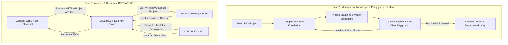

# DevLabLM — Multiple RAG Project

Sistem manajemen **Knowledge Base AI Modular** berbasis **Retrieval-Augmented Generation (RAG)** yang dibangun menggunakan arsitektur hybrid **JavaFX Desktop & Spring Boot Embedded Server**. 

Platform ini memungkinkan pembuatan, pengelolaan, dan isolasi knowledge secara spesifik per project. Setiap project dapat diuji secara langsung melalui playground interaktif di desktop dan menghasilkan **Dedicated REST API** mandiri yang siap dikonsumsi oleh aplikasi web, mobile, atau sistem pihak ketiga.

---

## 📌 Mengapa DevLabLM?

Ketika mengintegrasikan LLM ke dalam berbagai kebutuhan bisnis (seperti SOP HRD, Dokumentasi Teknis, atau Customer Support untuk produk berbeda), sering kali terjadi masalah:
1. **Context Bleeding (Pencampuran Konteks)**: Knowledge antar divisi atau project bercampur sehingga respon AI menjadi bias atau tidak akurat.
2. **Biaya & Kompleksitas Fine-Tuning**: Melatih ulang bobot model (*weight retraining*) membutuhkan biaya komputasi tinggi dan waktu yang lama.
3. **Ketiadaan Sarana Pengujian Lokal**: Sulit memvalidasi apakah dokumen yang dimasukkan sudah dijawab dengan benar oleh AI sebelum dirilis ke aplikasi web.

**DevLabLM** menyelesaikan masalah tersebut dengan pendekatan:
- **Zero-Retraining**: Cukup masukkan dokumen dan konfigurasi prompt; AI langsung memahami data spesifik menggunakan teknik RAG.
- **Strict Project Isolation**: Setiap knowledge base memiliki ruang vektor (*vector namespace*) terpisah.
- **Hybrid Desktop + API Gateway**: Kelola dan uji langsung di antarmuka desktop modern, lalu sajikan via REST API untuk integrasi web.

---

## 🌟 Fitur Utama

- **🗂️ Multi-Project Workspace**: Buat dan kelola banyak project chatbot/RAG dalam satu antarmuka terpusat tanpa saling mengganggu.
- **📚 Knowledge Ingestion & Indexing**: Pengunggahan dan pemrosesan dokumen (ekstraksi teks, pemotongan konteks/*chunking*, serta pembuatan *vector embeddings*).
- **💬 Free Chat Testing Playground**: Ruang simulasi percakapan interaktif di desktop untuk menguji pemahaman AI dan relevansi retrieval dokumen sebelum live di production.
- **⚙️ Pengaturan Provider AI Terpadu**: Dukungan konfigurasi provider AI / LLM (OpenAI, Ollama, Local LLM, endpoint kustom, API Key, serta pemilihan model).
- **🌐 Dedicated REST API Server**: Server HTTP Spring Boot tertanam (*embedded*) yang melayani permintaan tanya-jawab dari aplikasi web/klien eksternal berdasarkan identitas project.
- **🎨 Modern Desktop UI**: Antarmuka berbasis JavaFX dengan tema modern AtlantaFX dan Material Design Icons.

---

## 🔄 Alur Kerja Sistem (Workflow)

Sistem bekerja dalam dua fase berkesinambungan:



### Tahapan Detail:
1. **Pembuatan Project**: Tetapkan nama dan batasan domain (misal: *SOP Operasional*, *Dokumentasi Produk API*).
2. **Indexing & Ekstraksi RAG**: Dokumen dipecah menjadi unit-unit informasi kecil (*chunks*) dan dipetakan ke dalam ruang vektor secara terisolasi.
3. **Validasi Respon (Desktop Playground)**: Lakukan uji tanya-jawab langsung di aplikasi desktop untuk memastikan akurasi data dan meminimalkan halusinasi model.
4. **Penerbitan API Project**: Setiap project siap diakses secara remote oleh aplikasi luar melalui endpoint REST API yang aman.

---

## 🏗️ Arsitektur Teknologi

Aplikasi ini menggunakan perpaduan teknologi Java modern:

| Komponen | Teknologi | Deskripsi |
|---|---|---|
| **Core Framework** | Spring Boot 4.x / Java 25 | Injeksi dependensi, konfigurasi aplikasi, dan web service |
| **Desktop UI** | JavaFX 23 & FXML | Antarmuka grafis desktop native yang responsif |
| **UI Styling** | AtlantaFX 2.0 & Ikonli Material2 | Tampilan modern, tema bersih, dan icon pack komprehensif |
| **API Server** | Spring Web (Tomcat Embedded) | Menyediakan endpoint REST API di latar belakang |
| **Pattern** | MVC / Event-Driven | Integrasi siklus hidup Spring Boot dan JavaFX (`StageReadyEvent`) |

---

## 📁 Struktur Direktori

```text
devlablm/
├── src/
│   ├── main/
│   │   ├── java/id/guruh/devlablm/
│   │   │   ├── DevlablmApplication.java    # Titik masuk utama Spring Boot
│   │   │   ├── JavaFxApplication.java      # Titik masuk siklus hidup JavaFX
│   │   │   ├── controller/                 # REST API Controller (Spring Web)
│   │   │   │   └── ApiController.java
│   │   │   ├── service/                    # Logika bisnis & integrasi data
│   │   │   │   └── AppService.java
│   │   │   ├── model/                      # Data Transfer Objects (DTO) / Records
│   │   │   │   └── ServerInfo.java
│   │   │   ├── event/                      # Event bridge Spring <-> JavaFX
│   │   │   │   └── StageReadyEvent.java
│   │   │   └── ui/                         # Komponen UI JavaFX
│   │   │       ├── FxmlViewLoader.java     # Helper loader tampilan FXML
│   │   │       ├── StageInitializer.java   # Inisialisasi jendela desktop utama
│   │   │       └── controller/             # Controller tampilan FXML (Dashboard, Settings, AI)
│   │   └── resources/
│   │       ├── css/app.css                 # Custom CSS overrides
│   │       ├── fxml/                       # Berkas tata letak antarmuka FXML
│   │       │   ├── main.fxml
│   │       │   ├── dashboard.fxml
│   │       │   ├── ai-settings.fxml
│   │       │   └── settings.fxml
│   │       └── application.properties      # Konfigurasi aplikasi & server port
│   └── test/                               # Unit & integration testing
├── pom.xml                                 # Konfigurasi dependensi Maven
└── README.md                               # Dokumentasi project
```

---

## 🚀 Panduan Memulai

### Prasyarat Sistem
- **Java Development Kit (JDK)**: Versi 21 atau versi 25 (LTS yang didukung).
- **Maven**: Opsional (aplikasi sudah menyertakan Maven Wrapper `./mvnw`).
- **Koneksi Internet**: Diperlukan saat build pertama kali untuk mendownload pustaka dependensi.

### 1. Clone Repository
```bash
git clone https://github.com/RP-Guruh/multiple-rag-project.git
cd multiple-rag-project
```

### 2. Beri Izin Eksekusi Maven Wrapper (Linux / macOS)
```bash
chmod +x mvnw
```

### 3. Menjalankan Aplikasi

Aplikasi akan otomatis menyalakan server REST API Spring Boot sekaligus membuka jendela antarmuka JavaFX:

- **Linux / macOS**:
  ```bash
  ./mvnw spring-boot:run
  ```

- **Windows (CMD / PowerShell)**:
  ```cmd
  mvnw.cmd spring-boot:run
  ```

### 4. Build Executable JAR untuk Distribusi
Untuk mengemas seluruh aplikasi menjadi standalone runnable JAR:
```bash
./mvnw clean package -DskipTests
```
Hasil file `.jar` akan berada di folder `target/` dan dapat dijalankan dengan perintah:
```bash
java -jar target/devlablm-0.0.1-SNAPSHOT.jar
```

---

## 🔌 Dokumentasi REST API

Secara bawaan, Spring Boot menjalankan embedded HTTP server pada port yang dikonfigurasikan di `application.properties` (default: port `8080`).

### Contoh Endpoint:
- **Cek Status Server**:
  ```http
  GET /api/status
  ```
  **Response**:
  ```json
  {
    "appName": "DevLabLM",
    "status": "RUNNING",
    "port": 8080,
    "timestamp": "2026-10-25T17:00:00"
  }
  ```

---

## 📄 Lisensi & Kontribusi

Proyek ini dikembangkan secara open-source. Kontribusi berupa bug report, saran perbaikan fitur, maupun pull request sangat diterima.
